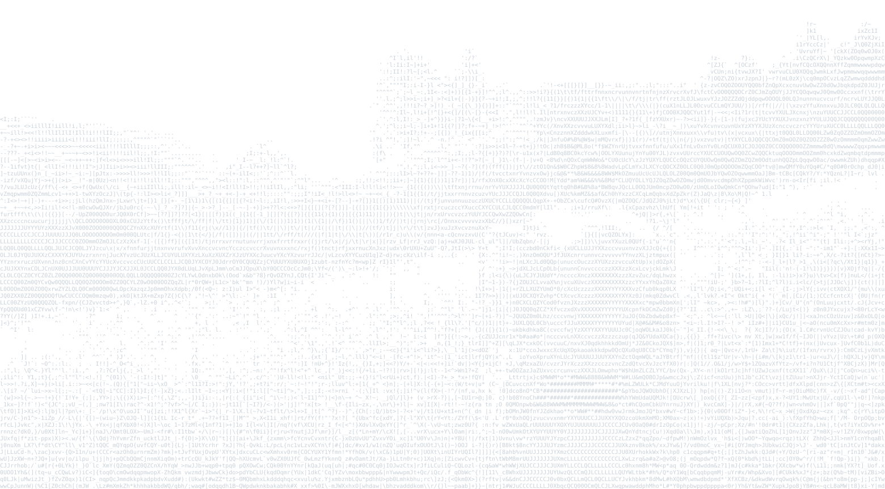

# thorfinn

I built this because my days pull in too many directions at once: studies, work, something I'm building, a group I lead, training, and money. The information never stops, and I was spending more energy sorting it than acting on it. So I set up a council of six advisors, each named after someone from Vinland Saga, to carry the noise for me. Each one reads only its own domain, writes only to its own tab, and never acts on my behalf. They advise, track and warn. I decide.

It's written as a baseline anyone can use. Swap in your own sources, fill in the bracketed context in each prompt, and drop any member you don't need.

## Leif, the Navigator

## Einar, the Farmer

## Askeladd, the Strategist

## Thors, the True Warrior

## Canute, the King

## Thorkell, the Giant

## How it runs

- One Claude Project holds the charter as its instructions.
- Six scheduled tasks live inside that Project, one per member, each on its own cadence.
- Each member writes only to its own tab in a hub Sheet.
- Leif alone writes the daily brief.

## Layout

- `CHARTER.md`: the council charter that goes into the Project instructions, with placeholders to fill in.
- `SCHEDULE.md`: when each member runs and what it reads and writes.
- `members/`: one file per member with its role, scope, sources, cadence and prompt.
- `hub-sheet.md`: the structure of the hub Sheet and its tabs.
- `SETUP.md`: the checklist to get the council running.
- `CHANGELOG.md`: changes to the council over time.

 

